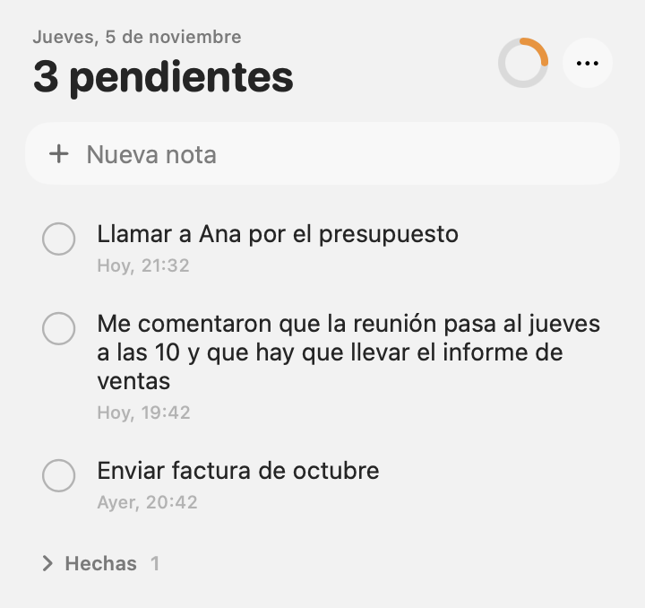

<p align="center">
  
</p>

<h1 align="center">Notas Rápidas</h1>

<p align="center">
  Anota lo que tienes que hacer o lo que te acaban de comentar, sin salir de lo que estás haciendo.<br>
  Vive en la barra de menú de macOS y te muestra cuántos pendientes quedan.
</p>

<p align="center">
  
</p>

## Funciones

- **Siempre a la vista:** el icono de la barra de menú muestra el número de pendientes.
- **Captura inmediata:** haz clic en el icono, escribe y pulsa Enter.
- **Hechas sin perderlas:** al marcar una nota pasa a la sección "Hechas", desde donde puedes recuperarla o borrarla.
- **Editar y borrar:** pasa el ratón sobre una nota y aparecen el lápiz y la papelera.
- **Contexto de cada nota:** fecha y hora de creación ("Hoy, 21:14", "Ayer, 20:24", "3 nov, 9:30").
- **Inicio automático:** actívalo en el menú `···` con "Abrir al iniciar sesión".
- **Solo local:** sin cuentas, sin red y sin paquetes externos.

## Requisitos

- macOS 26 o posterior.
- Xcode instalado en `/Applications/Xcode.app`. Las Command Line Tools no bastan porque no incluyen las macros de SwiftUI.

## Instalación

```sh
gh repo clone Luis24M/notas-rapidas
cd notas-rapidas
./scripts/install.sh
```

El script compila en modo release, reemplaza `/Applications/NotasRapidas.app`, la firma de forma local (ad-hoc) y la abre. Si la app estaba abierta, la reinicia. Tus notas no se tocan.

Vuelve a ejecutarlo para instalar cualquier cambio.

## Tus datos

Las notas se guardan en un archivo JSON:

```
~/Library/Application Support/NotasRapidas/notas.json
```

- Cada cambio se escribe al momento y de forma atómica.
- Si el archivo no se puede leer, la app muestra el error y no lo modifica, para no sobrescribir tus notas con una lista vacía.
- Si falla el guardado, el panel avisa en rojo.

## Desarrollo

```sh
export DEVELOPER_DIR=/Applications/Xcode.app/Contents/Developer

swift build
swift test
swift scripts/make-icon.swift Resources/AppIcon.icns   # regenera el icono
```

`DEVELOPER_DIR` selecciona el toolchain de Xcode solo para esa sesión, sin cambiar `xcode-select`.

### Estructura

| Ruta | Contenido |
| --- | --- |
| `Sources/NotasCore/` | Modelo de notas y guardado, sin dependencia de la interfaz |
| `Sources/NotasRapidas/` | App y vistas en SwiftUI |
| `Tests/NotasCoreTests/` | Pruebas de `NoteStore` |
| `scripts/install.sh` | Compila, empaqueta e instala el `.app` |
| `scripts/make-icon.swift` | Dibuja el icono y genera el `.icns` |
| `Resources/AppIcon.icns` | Icono de la app |
| `Info.plist` | Metadatos del paquete; `LSUIElement` la oculta del Dock |

## Desinstalar

Sal de la app desde el menú `···` y borra la app y, si quieres, tus notas:

```sh
rm -rf /Applications/NotasRapidas.app
rm -rf ~/Library/Application\ Support/NotasRapidas
```

Si activaste "Abrir al iniciar sesión", desactívalo antes de borrar la app.

## Distribución

Es un proyecto personal y no se publica. La firma ad-hoc sirve para compilar y usar la app en tu propio Mac; para distribuirla haría falta firmarla con una cuenta de desarrollador y notarizarla.
